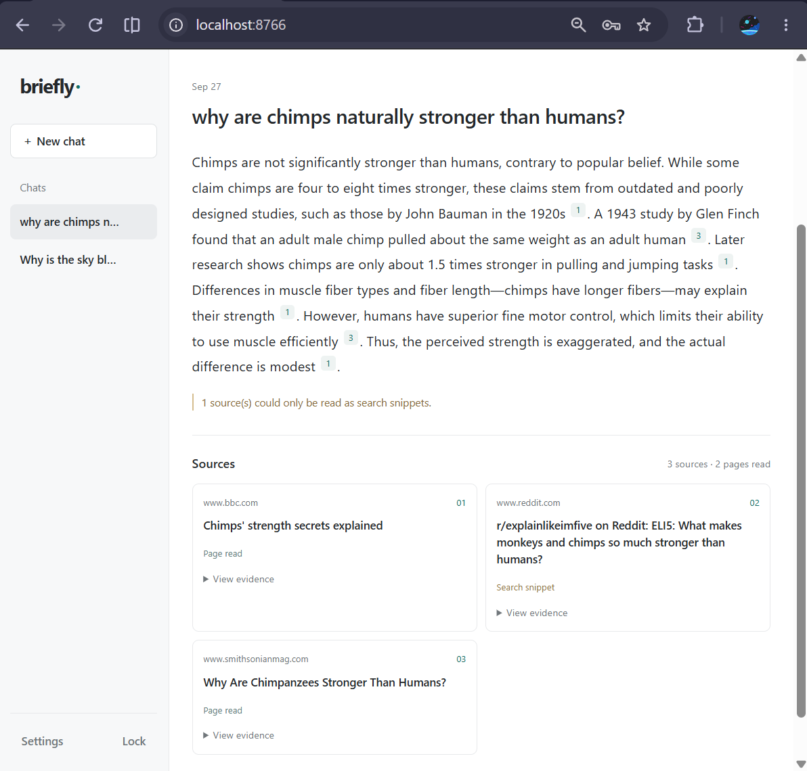

# Briefly

Ask a question. Read less. Get a concise answer with sources, powered by your local model.

- Searches the web and reads a few relevant pages.
- Summarizes with **GenieX, Ollama, or an OpenAI-compatible local server**.
- Keeps answers short, with clickable citations and source excerpts.
- Saves chat history locally, with delete and undo controls.
- Runs on Windows or macOS, with one model request per question.

## Get started

You’ll need **Python 3.10+** and a running local model server. Your workspace access key is generated automatically on first launch.

**[Setup guide →](setup.md)** — installation, model connections, LAN access, and troubleshooting notes.

Web search uses external providers; summarization runs on your configured model. No paid search API key is required.
